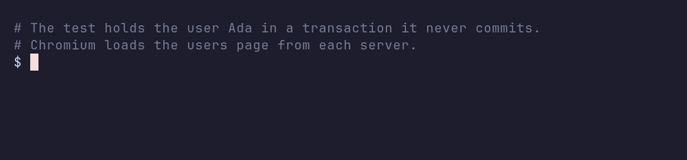

# HttpServer: an in-process HTTP server for Pest and PHPUnit browser tests, built for coding agents

[](https://github.com/sorge-it/http-server/actions/workflows/tests.yml?query=branch%3Amain)
[](https://github.com/sorge-it/http-server/actions/workflows/frankenphp.yml?query=branch%3Amain)
[](https://github.com/sorge-it/http-server/actions/workflows/go-net-http.yml?query=branch%3Amain)
[](https://github.com/sorge-it/http-server/actions/workflows/works-with.yml?query=branch%3Amain)
[](https://packagist.org/packages/sorge-it/http-server)
[](composer.json)
[](LICENSE)

**Your browser test creates a user inside a database transaction, and the page does not show it.
`sorge-it/http-server` is an in-process HTTP/1.1 server for Pest and PHPUnit browser tests, built
for coding agents. It serves the page from the test process, so the page sees the test's
`RefreshDatabase` transaction, `actingAs()` user and fakes.**



The demo in [`demo/`](demo) holds a transaction with the user Ada, as Laravel's `RefreshDatabase`
does, while headless Chromium loads a page that lists the users. Served by `php -S`, the page shows
no users; served by HttpServer, it shows Ada.

- **Testing a Laravel app with Pest?** You do not call this package yourself:
  [`sorge-it/pest-plugin-browser-cdp`](https://github.com/sorge-it/pest-plugin-browser-cdp) serves
  your app with it, so `RefreshDatabase`, `actingAs()` and fakes such as `Mail::fake()` reach the
  page.
- **Already using `pestphp/pest-plugin-browser`?** There, the page sees the test's state too.
  [`pest-plugin-browser-cdp`](https://github.com/sorge-it/pest-plugin-browser-cdp) runs your tests
  on HttpServer instead, without Node and Playwright. For the methods that its README marks `built`,
  it is [faster and uses half the
  memory](https://github.com/sorge-it/pest-plugin-browser-cdp#measurements).
- **Testing another framework or plain PHP, or building a browser driver or test harness?** Read on:
  the handler is a callable that turns a `Request` into a `Response`.
  [Works with Symfony, Laravel and PSR-15](#works-with-symfony-laravel-and-psr-15) has a handler
  for each.
- **Using Laravel Dusk, Symfony Panther or another WebDriver client?** This package does not work
  with them. A WebDriver client blocks the test process while the page loads, so the server never
  gets a tick.

Within its [scope](#scope), for each [valid request](#a-valid-request), the browser gets the bytes
that the pinned official FrankenPHP build sends over HTTP, apart from the
[deliberate differences](#deliberate-differences). Test suites compare each response live with the
FrankenPHP binary, and the parser with Go `net/http`. The server needs no event loop, because the
test calls `tick()` while it waits for the browser. The package depends on no other package. CI
requires 100% line and type coverage, and the weekly mutation tests require a score of at least
99%.

## Contents

1. [Why RefreshDatabase and actingAs() don't reach the page](#why-refreshdatabase-and-actingas-dont-reach-the-page)
2. [Built for coding agents](#built-for-coding-agents)
3. [Installation](#installation)
4. [Quick start](#quick-start)
5. [A browser test with Chrome](#a-browser-test-with-chrome)
6. [A driver's wait loop](#a-drivers-wait-loop)
7. [A handler's unit test](#a-handlers-unit-test)
8. [Works with Symfony, Laravel and PSR-15](#works-with-symfony-laravel-and-psr-15)
9. [Rules for tests](#rules-for-tests)
10. [When to use it and when not to](#when-to-use-it-and-when-not-to)
11. [Comparison with php -S, amphp/http-server and ReactPHP](#comparison-with-php--s-amphphttp-server-and-reactphp)
12. [API reference](#api-reference)
13. [HTTP behavior](#http-behavior)
14. [Compatibility with FrankenPHP](#compatibility-with-frankenphp)
15. [Development](#development)
16. [Support](#support)
17. [License](#license)
18. [About the author](#about-the-author)

Sections 1 to 11 are for users. Sections 12 to 14 are the reference: read them when you need a
detail.

## Why RefreshDatabase and actingAs() don't reach the page

A browser test needs an HTTP server for its app. The usual one runs in a second process:
`php artisan serve`, `php -S` or a container's web server. That process has its own database
connection, so it cannot see the test's uncommitted transaction or its `sqlite::memory:` database.
A login with `actingAs()`, a fake such as `Mail::fake()` or `Queue::fake()`, and a clock frozen with
`Carbon::setTestNow()` stay behind in the test process too. That is why
[Laravel Dusk](https://laravel.com/docs/13.x/dusk#resetting-the-database-after-each-test) asks for
`DatabaseMigrations` or `DatabaseTruncation` instead of `RefreshDatabase`: each test migrates or
empties the database again, which is slower.

A server in the test process sees all of it. `pestphp/pest-plugin-browser` uses
`amphp/http-server` for this, so the test waits for the browser inside amphp's event loop.
HttpServer has no event loop: the test keeps its own wait loop and ticks the server in it. That is
what a driver needs when it already waits on something else, such as Chrome's DevTools pipe.

## Built for coding agents

A coding agent knows only what the test run prints, and it takes a passing test as proof.
HttpServer makes both safe:

- **A passing test is proof.** A test server that responds differently from production lets a test
  pass against behavior that production does not have. So HttpServer follows the browser-visible
  HTTP/1.1 behavior of a pinned FrankenPHP build, within a documented [scope](#scope) and with
  documented [deliberate differences](#deliberate-differences). Where production runs nginx with
  PHP-FPM or Apache, headers and framing can differ; see
  [Compatibility](#compatibility-with-frankenphp).
- **The test shows the error.** With `onError: static fn (Throwable $e): never => throw $e`, a
  handler exception fails the test with its class, message, file and line
  ([test](tests/Handler/HandlerTest.php)). Laravel and Symfony catch the exceptions of their app
  first; see [Works with](#works-with-symfony-laravel-and-psr-15). Under `php -S` without a
  php.ini, the exception stays in the server process: the test gets status 200 and an HTML page
  with the fatal error (measured by hand on 2026-11-16; no suite repeats it).
- **Debug output is in the run.** `echo` and `var_dump()` in the app print into the test's output,
  as in a unit test, and `error_log()` writes where the test process logs
  ([test](tests/BeyondGo/SharedStateTest.php)). The response body stays as the handler returned it.
- **No server process.** There is no server process to start, to wait for or to kill, and none is
  left after a failed run.
- **The test sees what the page did.** After a request, the test reads the same database
  transaction and the same fakes as the app ([test](works-with/laravel/WorksWithTest.php)).

## Installation

```sh
composer require --dev sorge-it/http-server
```

It requires PHP 8.4 or a later 8.x, the extension `ext-filter`, which PHP builds by default, and
no other packages. It runs on Linux and macOS: CI runs the suites on Ubuntu, Debian, Alpine and
macOS. Windows is not supported, because no CI job runs there.
Versions follow [Semantic Versioning](https://semver.org): the classes and the interface marked
`@api` are the public API, and [CHANGELOG.md](CHANGELOG.md) lists each change.

## Quick start

Save this as `serve.php` in the project root, run `php serve.php`, and open the URL it prints
within 60 seconds:

```php
<?php

declare(strict_types=1);

use SorgeIt\HttpServer\Request;
use SorgeIt\HttpServer\Response;
use SorgeIt\HttpServer\Server;

require __DIR__.'/vendor/autoload.php';

$server = new Server(static fn (Request $request): Response => new Response(200, ['Content-Type' => 'text/plain'], 'Hello '.$request->path()));

echo $server->url(), "\n"; // http://127.0.0.1:49152, a free port

$until = hrtime(true) / 1e9 + 60;

while (hrtime(true) / 1e9 < $until) {
    $server->tick(0.05); // accepts, reads, calls the handler and writes what is ready, then returns
}

$server->close();
```

## A browser test with Chrome

The test holds a user in a transaction it never commits. Chrome loads the page in its own process,
and the test serves the page while it waits for Chrome.

Install Pest:

```sh
composer config allow-plugins.pestphp/pest-plugin true
composer require --dev pestphp/pest --with-all-dependencies
```

Any local Chrome or Chromium works. For CI and for teams,
[`sorge-it/cdp-browser-installer`](https://github.com/sorge-it/cdp-browser-installer) pins a
headless Chrome, so every run uses the same build. `pin` downloads the archives for all platforms
once and writes `.chrome-version`; commit that file. Pick a version
from the [Chrome for Testing dashboard](https://googlechromelabs.github.io/chrome-for-testing/):

```sh
composer require --dev sorge-it/cdp-browser-installer
sudo vendor/bin/cdp-browser deps
vendor/bin/cdp-browser pin <version>
vendor/bin/cdp-browser install
```

`deps` installs the tools and libraries that `pin`, `install` and Chrome need, once per machine.
When you run as root, such as in a container, run `deps` without `sudo`; `pin` and `install` then
take `--allow-root`. On Linux, the pinned Chrome runs on glibc only. On Alpine, run only `deps`,
which installs Chromium, and set `CHROME=/usr/bin/chromium`.

Save the test as `tests/ChromeTest.php`. It needs the `pdo_sqlite` extension:

```php
<?php

declare(strict_types=1);

use SorgeIt\HttpServer\Request;
use SorgeIt\HttpServer\Response;
use SorgeIt\HttpServer\Server;

it("shows Chrome a user that exists only in the test's transaction", function (): void {
    $db = new PDO('sqlite::memory:');
    $db->exec('CREATE TABLE users (name TEXT)');
    $db->beginTransaction(); // like Laravel's RefreshDatabase: never committed
    $db->exec("INSERT INTO users (name) VALUES ('Ada')");

    $server = new Server(static function (Request $request) use ($db): Response {
        if ($request->path() !== '/users') {
            return new Response(404); // answer every path: a browser may also ask for /favicon.ico
        }

        $names = $db->query('SELECT name FROM users')->fetchAll(PDO::FETCH_COLUMN);

        return new Response(200, ['Content-Type' => 'text/html'], '<h1>'.implode(', ', $names).'</h1>');
    }, onError: static fn (Throwable $e): never => throw $e); // a handler exception fails the test immediately
    $chrome = null;

    try {
        // Chrome loads the page in its own process; the test serves the page while it waits.
        $chrome = proc_open(
            [getenv('CHROME') ?: throw new RuntimeException('Set CHROME to the path of Chrome'), '--headless', ...(PHP_OS_FAMILY === 'Linux' ? ['--no-sandbox'] : []), '--dump-dom', $server->url().'/users'],
            [1 => ['pipe', 'w'], 2 => STDERR],
            $pipes,
        ) ?: throw new RuntimeException('Chrome did not start');
        stream_set_blocking($pipes[1], false);
        $dom = '';
        $deadline = hrtime(true) / 1e9 + 30; // the first start of Chrome on a new machine is slow

        // Chrome prints the DOM once the page has loaded; its exit can take longer.
        while (! str_contains($dom, '</html>') && hrtime(true) / 1e9 < $deadline) {
            $server->tick(0.01);
            $dom .= fread($pipes[1], 8192);
        }

        if (! str_contains($dom, '</html>')) {
            throw new RuntimeException('Chrome printed no page within 30 s');
        }
    } finally {
        if (is_resource($chrome)) {
            proc_terminate($chrome); // ends Chrome, which may still be exiting
            proc_close($chrome);
        }

        $server->close();
    }

    expect($dom)->toContain('<h1>Ada</h1>');
});
```

Run it with the browser's path in `CHROME`:

```sh
CHROME="$(vendor/bin/cdp-browser path chrome-headless-shell)" vendor/bin/pest tests/ChromeTest.php
# or, with a local Chrome on macOS:
CHROME="/Applications/Google Chrome.app/Contents/MacOS/Google Chrome" vendor/bin/pest tests/ChromeTest.php
```

- The suite runs this example as [`tests/Example/ChromeTest.php`](tests/Example/ChromeTest.php), in
  CI on Ubuntu and macOS.
- In PHPUnit, the same code goes into a test method, with `assertStringContainsString()` instead of
  `expect()`.
- On Linux, the test passes `--no-sandbox`: current Ubuntu releases and most containers block the
  sandbox, and Chrome then stops with `No usable sandbox!`. Chrome's errors go to the test's output.
- `--dump-dom` loads one page and prints its DOM. A navigation started by a script may not appear
  in the dump. To click on the page, a driver speaks the Chrome DevTools Protocol, as
  `pest-plugin-browser-cdp` does.

### Waiting for a request

To wait until Chrome has submitted a form, the handler stores the form in a variable, and the test
ticks until the variable is set or a deadline passes. The handler also serves the form and the page
that the redirect after the POST leads to. Save it as `tests/FormTest.php`:

```php
<?php

declare(strict_types=1);

use SorgeIt\HttpServer\Request;
use SorgeIt\HttpServer\Response;
use SorgeIt\HttpServer\Server;

it('receives the form that Chrome submits', function (): void {
    $posted = null;

    $server = new Server(static function (Request $request) use (&$posted): Response {
        if ($request->method === 'GET' && $request->path() === '/form') {
            // The script submits the form, as a click on Save would.
            return new Response(200, ['Content-Type' => 'text/html'], '<form method="post" action="/users"><input name="name" value="Ada"><button>Save</button></form><script>document.forms[0].requestSubmit()</script>');
        }

        if ($request->method === 'POST' && $request->path() === '/users') {
            parse_str((string) $request->body, $posted); // read the body here: after the handler, it is closed

            return new Response(303, ['Location' => '/saved']);
        }

        if ($request->method === 'GET' && $request->path() === '/saved') {
            return new Response(200, ['Content-Type' => 'text/html'], '<h1>Saved</h1>');
        }

        return new Response(404);
    }, onError: static fn (Throwable $e): never => throw $e);
    $chrome = null;

    try {
        $chrome = proc_open(
            [getenv('CHROME') ?: throw new RuntimeException('Set CHROME to the path of Chrome'), '--headless', ...(PHP_OS_FAMILY === 'Linux' ? ['--no-sandbox'] : []), '--dump-dom', $server->url().'/form'],
            [1 => ['file', '/dev/null', 'w'], 2 => STDERR],
            $pipes,
        ) ?: throw new RuntimeException('Chrome did not start');
        $deadline = hrtime(true) / 1e9 + 30; // the first start of Chrome on a new machine is slow

        // Ticks until the handler has the form. The handler matches by method and path, because a
        // browser sends its requests in no fixed order.
        while ($posted === null && hrtime(true) / 1e9 < $deadline) {
            $server->tick(0.01);
        }
    } finally {
        if (is_resource($chrome)) {
            proc_terminate($chrome); // end Chrome first: after close(), its next request would find no server
            proc_close($chrome);
        }

        $server->close();
    }

    expect($posted)->toBe(['name' => 'Ada']);
});
```

- Once the variable is set, the handler has run. Its response follows in the same tick or a later
  one. To check the page after the redirect, tick until Chrome has loaded it, as the first test
  does.
- Call `tick()` with a wait, such as `tick(0.01)`. `tick(0)` returns immediately, and a loop of it
  keeps a CPU core busy.
- The suite runs this example as [`tests/Example/FormTest.php`](tests/Example/FormTest.php).

## A driver's wait loop

A driver that already waits on streams of its own, such as Chrome's DevTools pipe, puts the
server's sockets into its own `stream_select()`, waits no longer than `timeout()`, and calls
`tick(0)` after each wait. This script echoes each line from STDIN while it serves, until STDIN
ends (Ctrl-D in a terminal). Save it as `loop.php`, run `php loop.php`, type a few lines, and open
the URL in a browser in the meantime:

```php
<?php

declare(strict_types=1);

use SorgeIt\HttpServer\Request;
use SorgeIt\HttpServer\Response;
use SorgeIt\HttpServer\Server;

require __DIR__.'/vendor/autoload.php';

$server = new Server(static fn (Request $request): Response => new Response(200, ['Content-Type' => 'text/plain'], 'Hello '.$request->path()));
echo $server->url(), "\n";
stream_set_blocking(STDIN, false);

while (! feof(STDIN)) {
    [$read, $write] = $server->streams();
    $read[] = STDIN; // a stream of the driver, such as Chrome's DevTools pipe
    $except = null;
    $seconds = min(1.0, $server->timeout() ?? 1.0);

    $ready = stream_select($read, $write, $except, (int) $seconds, (int) (fmod($seconds, 1.0) * 1e6));

    if ($ready > 0 && in_array(STDIN, $read, true) && ($line = fgets(STDIN)) !== false) {
        echo 'stdin: ', $line;
    }

    $server->tick(0); // handles what is ready, and closes each connection past its timeout
}

$server->close();
```

## A handler's unit test

A handler is a plain callable, so a unit test calls it without a server, a socket or a browser.
`StringBody` gives the request a body; a `Request` without one has an empty body. The test checks
the `Response` by its public properties:

```php
<?php

declare(strict_types=1);

use SorgeIt\HttpServer\Request;
use SorgeIt\HttpServer\Response;
use SorgeIt\HttpServer\StringBody;

it('saves the posted user and redirects', function (): void {
    $posted = null;
    $handler = static function (Request $request) use (&$posted): Response {
        parse_str((string) $request->body, $posted);

        return new Response(303, ['Location' => '/saved']);
    };

    $response = $handler(new Request('POST', '/users', ['content-type' => ['application/x-www-form-urlencoded']], new StringBody('name=Ada')));

    expect($response->status)->toBe(303)
        ->and($response->headers)->toBe(['Location' => '/saved'])
        ->and($posted)->toBe(['name' => 'Ada']);
});
```

## Works with Symfony, Laravel and PSR-15

The handler gets a `Request` of this package and returns a `Response` of this package, not PSR-7 or
HttpFoundation objects. Each file below converts them, so a Symfony kernel, a Laravel app or a
PSR-15 request handler serves the page from the test process. Save the file in `tests/` and load
it once, with `require_once` where the test creates the server, or from `tests/Pest.php`. Each
file:

- parses a body of `application/x-www-form-urlencoded` into form fields. A multipart body stays
  unparsed, so an upload has no files.
- holds the response body in memory.
- passes every path to the app. A file in `public/`, such as a built stylesheet, needs a route or
  a branch in the handler.
- leaves an exception from the app to the framework. Laravel, and Symfony with `FrameworkBundle`,
  answer with their error page, so `onError` gets no exception. In a Laravel test,
  `$this->withoutExceptionHandling([NotFoundHttpException::class])` turns this off: each exception
  from the app reaches `onError`, except a class in the list. So a missing route, such as
  `/favicon.ico`, still gets its 404. A form that fails validation throws a `ValidationException`:
  add its class to the list when the test expects the framework's response. In a Symfony test,
  `catch: false` in the call of `handle()` in `symfonyHandler()` passes each exception from the app
  to `onError`, also the `NotFoundHttpException` of `/favicon.ico`.

The weekly CI job [`works-with`](.github/workflows/works-with.yml) runs each file with the newest
release of its framework. A client in a second process posts a form with a query, a cookie and a
header. The app answers with status 201, a header and two cookies; Symfony and Laravel answer
with a `StreamedResponse`.

### Symfony

`symfonyHandler()` passes each request to a Symfony kernel, such as the kernel of
`KernelTestCase::bootKernel()`: `new Server(symfonyHandler(self::bootKernel()))`. Save the code
below as `tests/symfony.php`. It needs `symfony/http-kernel`.

```php
<?php

declare(strict_types=1);

use SorgeIt\HttpServer\Request;
use SorgeIt\HttpServer\Response;
use Symfony\Component\HttpFoundation\Request as SymfonyRequest;
use Symfony\Component\HttpFoundation\Response as SymfonyResponse;
use Symfony\Component\HttpKernel\HttpKernelInterface;
use Symfony\Component\HttpKernel\TerminableInterface;

/**
 * A handler for `new Server()` that passes each request to a Symfony kernel in the test process.
 */
function symfonyHandler(HttpKernelInterface $kernel): Closure
{
    return static function (Request $request) use ($kernel): Response {
        $symfonyRequest = symfonyRequest($request);
        $symfonyResponse = $kernel->handle($symfonyRequest)->prepare($symfonyRequest);
        $response = serverResponse($symfonyResponse);

        if ($kernel instanceof TerminableInterface) {
            $kernel->terminate($symfonyRequest, $symfonyResponse);
        }

        return $response;
    };
}

/**
 * Converts the request into a Symfony request. An `application/x-www-form-urlencoded` body also
 * fills the form fields; a multipart body stays unparsed, so the request has no uploaded files.
 */
function symfonyRequest(Request $request): SymfonyRequest
{
    $server = [
        'REQUEST_METHOD' => $request->method,
        'REQUEST_URI' => $request->target,
        'QUERY_STRING' => $request->query(),
        'SERVER_PROTOCOL' => 'HTTP/1.1',
        'REMOTE_ADDR' => trim(substr($request->remoteAddress, 0, (int) strrpos($request->remoteAddress, ':')), '[]'),
    ];

    foreach ($request->headers as $name => $values) {
        $key = strtoupper(strtr($name, '-', '_'));
        $server[in_array($key, ['CONTENT_TYPE', 'CONTENT_LENGTH'], true) ? $key : 'HTTP_'.$key] = implode(', ', $values);
    }

    $cookies = [];

    foreach (explode(';', $request->header('Cookie') ?? '') as $pair) {
        [$name, $value] = array_pad(explode('=', trim($pair), 2), 2, '');

        if ($name !== '') {
            $cookies[$name] = urldecode($value);
        }
    }

    parse_str($request->query(), $query);
    $body = (string) $request->body;
    $form = [];

    if (str_starts_with(strtolower($request->header('Content-Type') ?? ''), 'application/x-www-form-urlencoded')) {
        parse_str($body, $form);
    }

    return new SymfonyRequest($query, $form, [], $cookies, [], $server, $body);
}

/**
 * Converts a Symfony response, with the body that `sendContent()` writes, so a `StreamedResponse`
 * works too. The body is held in memory.
 */
function serverResponse(SymfonyResponse $response): Response
{
    $body = '';
    ob_start(static function (string $buffer) use (&$body): string {
        $body .= $buffer;

        return '';
    });

    try {
        $response->sendContent();
    } finally {
        ob_end_flush();
    }

    return new Response($response->getStatusCode(), $response->headers->all(), $body);
}
```

### Laravel

`laravelHandler()` passes each request to the test's app, as `$this->get()` does, so the page sees
the `RefreshDatabase` transaction, the `actingAs()` user and fakes such as `Mail::fake()`. Use it
for a PHPUnit test, or for a driver of your own, without
[`pest-plugin-browser-cdp`](https://github.com/sorge-it/pest-plugin-browser-cdp). In a test that
extends Laravel's `TestCase`, such as one in `tests/Feature`, create the server with
`new Server(laravelHandler($this->app))`. Save the code below as `tests/laravel.php`, next to
`tests/symfony.php`; Laravel already requires `symfony/http-kernel`. `pest-plugin-browser-cdp`
does more: it serves the files in `public/`, and it clears what one request leaves in the
container before the next request.

```php
<?php

declare(strict_types=1);

use Illuminate\Contracts\Foundation\Application;
use Illuminate\Contracts\Http\Kernel;
use Illuminate\Http\Request as LaravelRequest;
use SorgeIt\HttpServer\Request;
use SorgeIt\HttpServer\Response;

require_once __DIR__.'/symfony.php';

/**
 * A handler for `new Server()` that passes each request to a Laravel test's app, as
 * `$this->get()` does: the page sees the test's transaction, its user and its fakes.
 */
function laravelHandler(Application $app): Closure
{
    return static function (Request $request) use ($app): Response {
        $kernel = $app->make(Kernel::class);
        $laravelRequest = LaravelRequest::createFromBase(symfonyRequest($request));
        $laravelResponse = $kernel->handle($laravelRequest);
        $response = serverResponse($laravelResponse);
        $kernel->terminate($laravelRequest, $laravelResponse);

        return $response;
    };
}
```

### PSR-15

`psr15Handler()` passes each request to a PSR-15 request handler, such as a Slim app. A PSR-17
factory, such as `Psr17Factory` of `nyholm/psr7`, builds the request:
`new Server(psr15Handler($app, $factory, $factory))`. Save the code below as `tests/psr-15.php`.

```php
<?php

declare(strict_types=1);

use Psr\Http\Message\ServerRequestFactoryInterface;
use Psr\Http\Message\StreamFactoryInterface;
use Psr\Http\Server\RequestHandlerInterface;
use SorgeIt\HttpServer\Request;
use SorgeIt\HttpServer\Response;

/**
 * A handler for `new Server()` that passes each request to a PSR-15 request handler, such as a
 * Slim app. A PSR-17 factory, such as `Nyholm\Psr7\Factory\Psr17Factory`, builds the request.
 * A multipart body stays unparsed: the request has no uploaded files.
 */
function psr15Handler(RequestHandlerInterface $handler, ServerRequestFactoryInterface $requests, StreamFactoryInterface $streams): Closure
{
    return static function (Request $request) use ($handler, $requests, $streams): Response {
        $cookies = [];

        foreach (explode(';', $request->header('Cookie') ?? '') as $pair) {
            [$name, $value] = array_pad(explode('=', trim($pair), 2), 2, '');

            if ($name !== '') {
                $cookies[$name] = urldecode($value);
            }
        }

        parse_str($request->query(), $query);
        $body = (string) $request->body;
        $server = ['REMOTE_ADDR' => trim(substr($request->remoteAddress, 0, (int) strrpos($request->remoteAddress, ':')), '[]')];
        $psrRequest = $requests->createServerRequest($request->method, 'http://'.$request->header('Host').$request->target, $server)
            ->withCookieParams($cookies)
            ->withQueryParams($query)
            ->withBody($streams->createStream($body));

        foreach ($request->headers as $name => $values) {
            $psrRequest = $psrRequest->withHeader($name, $values);
        }

        if (str_starts_with(strtolower($request->header('Content-Type') ?? ''), 'application/x-www-form-urlencoded')) {
            parse_str($body, $form);
            $psrRequest = $psrRequest->withParsedBody($form);
        }

        $psrResponse = $handler->handle($psrRequest);

        return new Response($psrResponse->getStatusCode(), $psrResponse->getHeaders(), (string) $psrResponse->getBody());
    };
}
```

## Rules for tests

| Rule | What happens otherwise |
|---|---|
| Call `tick()` while you wait for the browser | The page never loads. |
| Never block the process while the browser loads: no blocking client, such as `file_get_contents($server->url())`, Guzzle, Symfony HttpClient or curl without a tick, and no blocking read of the browser's output, such as `stream_get_contents($pipes[1])` | The test hangs until a client or the job times out, and the server never sees the request. |
| Return a `Response` from the handler | `echo`, `header()`, `setcookie()` and `http_response_code()` in the handler do not reach the browser; `exit`, also through `dd()`, ends the test process. Convert an app's response into a `Response`. |
| Read the request from `Request` | The server fills no superglobals: `$_GET`, `$_POST`, `$_COOKIE`, `$_FILES` and `$_SERVER` keep the test process's values. `php://input` and `request_parse_body()` do not see the body. |
| Name the page's own request headers with letters, digits and `-` only, such as `X-Token` | A header field whose name contains `_` or `.`, such as `X_Token`, does not reach the handler, as in Caddy. |
| Read the body in the handler, and keep what the test checks, such as the parsed form | Once the handler returns, the server closes the body: a read of a `Request` kept for later returns `''`. |
| Set a `Content-Type` for a stylesheet or a script, such as `new Response(200, ['Content-Type' => 'text/css'], file: $path)` | The response gets `text/html` from `default_mimetype`, as in FrankenPHP, and Chrome refuses a stylesheet or module script with that type. |
| Answer every path, with a 404 as the default | A browser asks for `/favicon.ico` too; a handler that throws there makes the test fail. |
| Call `close()` in `finally` or `afterEach` | Errors that no `onError` received are lost, and the port stays open until PHP frees the server. |
| Set `onError: static fn (Throwable $e): never => throw $e`, unless the test expects a handler exception | The page shows an error response, and only `close()` throws the exception, as `ClosedWithErrors`, once the test's wait has ended. After a failed assertion, PHPUnit drops an exception that `afterEach` throws. |
| Never call `tick()` or `close()` from the handler | It throws a `LogicException`, and the request gets the response to an uncaught exception. |
| Return from the handler | A handler that never returns blocks the server, and its run time adds to the caller's wait. |
| Run the browser on the same host or in the same container as the test | A browser in another container cannot reach loopback. |

[onError and ClosedWithErrors](#onerror-and-closedwitherrors) explains what happens to a handler
error, and [HTTP behavior](#http-behavior) names what the server reads and what it rejects.

## When to use it and when not to

Use it for browser tests in which the page must see the test's state, and for drivers and test
harnesses that serve an app from the test process. Its clients are the test's browser and code in
the test process that ticks the server while it waits.

Do not use it for:

- Laravel Dusk, Symfony Panther or any other WebDriver client: they block the test process;
- a mock server for your own HTTP client, such as Guzzle or Symfony HttpClient: they block the
  process while the server needs a tick. Use Guzzle's `MockHandler`, Laravel's `Http::fake()` or
  Symfony's `MockHttpClient` instead;
- production, or any address other than loopback;
- TLS, HTTP/2 or HTTP/3;
- load tests or hostile clients: it limits neither the number of connections nor the total bytes
  across all clients;
- requests that no browser sends: it rejects each [request that is not valid](#a-valid-request)
  with `400 Bad Request`.

## Comparison with php -S, amphp/http-server and ReactPHP

| | `php -S`, `php artisan serve` | `amphp/http-server` 3.4.9, used by `pestphp/pest-plugin-browser` 5.2.0 | `react/http` 1.12.0 | `sorge-it/http-server` | Source |
|---|---|---|---|---|---|
| Runs in | a second process | the test process | the test process | the test process | [PHP manual](https://www.php.net/manual/en/features.commandline.webserver.php), [ServeCommand.php of Laravel 13.43.0](https://github.com/laravel/framework/blob/v13.43.0/src/Illuminate/Foundation/Console/ServeCommand.php), [LaravelHttpServer.php of pest-plugin-browser 5.2.0](https://github.com/pestphp/pest-plugin-browser/blob/v5.2.0/src/Drivers/LaravelHttpServer.php), [README of react/http 1.12.0](https://github.com/reactphp/http/blob/v1.12.0/README.md#server-usage) |
| The page can see the test's transaction, authenticated user and fakes | no | yes | yes | yes | the [demo](demo) for `php -S`; for the others, the handler runs in the test process |
| Event loop | none needed by the test | Revolt, with fibers | ReactPHP's loop | none: the test calls `tick()` | [composer.json of amphp/http-server 3.4.9](https://github.com/amphp/http-server/blob/v3.4.9/composer.json), [composer.json of react/http 1.12.0](https://github.com/reactphp/http/blob/v1.12.0/composer.json) |
| Direct dependencies | none for `php -S`, part of PHP; `php artisan serve` is part of `laravel/framework` and starts `php -S` | 13 | 7 | no packages; `ext-filter` of PHP | the same two files |
| TLS and HTTP/2 | no | TLS and HTTP/2 | TLS, no HTTP/2 | no: HTTP/1.1 on loopback only | [php_cli_server.c of PHP 8.4](https://github.com/php/php-src/blob/php-8.4.0/sapi/cli/php_cli_server.c), [README of amphp/http-server 3.4.9](https://github.com/amphp/http-server/blob/v3.4.9/README.md), [README of react/http 1.12.0](https://github.com/reactphp/http/blob/v1.12.0/README.md) |
| Built for | development and testing, not a public network | application servers | event-driven applications | browser tests on loopback | the PHP manual and the two READMEs |

HttpServer follows one server, the pinned official FrankenPHP build over HTTP, and its suites
compare the response to each valid request with it.

## API reference

The public API consists of the classes `Server`, `Request`, `StringBody`, `Response`, `Limits`,
`ListenFailed` and `ClosedWithErrors`, and the interface `Body`. Each is marked `@api`. Every other
class lives in the namespace `SorgeIt\HttpServer\Internal` and can change in any release.

| Call | Returns | Throws |
|---|---|---|
| `new Server(callable $handler, string $host = '127.0.0.1', int $port = 0, Limits $limits = new Limits, ?callable $onError = null)` | a server that listens on loopback: 127.0.0.0/8 or ::1. The server checks the address that `$host` resolves to, such as that of `localhost`, before it listens. Port 0 picks a free port, so parallel test processes do not collide. You can give an IPv6 address with or without brackets, such as `::1` | `ListenFailed`, a `RuntimeException`, if it cannot listen, or if `$host` resolves to an address that is not loopback |
| `Server::tick(float $seconds): void` | waits at most `$seconds`, then handles the work that is ready; see [Ticking and waiting](#ticking-and-waiting) | `ValueError` for seconds that are negative, not finite or above 1e8; `RuntimeException` when `stream_select()` fails or the listener yields no connection; an exception from `onError`; `LogicException` when called from the handler, or from `onError` in a tick |
| `Server::streams(): array{list<resource>, list<resource>}` | the sockets to pass to `stream_select()`, for reading and for writing; two empty lists once the server is closed. The server reads, writes and closes them; the caller only waits | none |
| `Server::timeout(): ?float` | the seconds until the next connection timeout, which no socket signals; null if no timeout runs | none |
| `Server::address(): string` | `127.0.0.1:49152`, or `[::1]:49152` for IPv6 | none |
| `Server::url(): string` | `http://` and the address: `http://127.0.0.1:49152` | none |
| `Server::close(): void` | closes every connection and the listener; a second call closes nothing more and only passes on the errors that an exception from `onError` held back | `ClosedWithErrors` if the server kept errors; an exception from `onError`; `LogicException` when called from the handler, or from `onError` in a tick |
| `new Request(string $method, string $target, array $headers = [], ?Body $body = null, string $remoteAddress = '')` | a request built in code, such as for a [handler's unit test](#a-handlers-unit-test). `$headers` maps a lowercase name to a list of values. A null body is empty | `ValueError` for a header name that is not lowercase, or values that are not a list |
| `new StringBody(string $bytes)` | a body with fixed bytes for a `Request` built in code. It behaves like a body that has arrived whole and has no error | `ValueError` from `read()` for a length below 1 |
| `Request::$method: string`, `Request::$target: string` | the method and the request target as they arrived. Chrome sends the standard methods in uppercase, and any other method as the page wrote it, such as `patch` | none |
| `Request::$headers: array<string, list<string>>` | each header name in lowercase, mapped to its values. The handler gets no header field whose name contains `_` or `.`, as in Caddy | none |
| `Request::$body: Body` | the request body; see [The request body](#the-request-body) | none |
| `Request::$remoteAddress: string` | the client's IP and port, like Go's `RemoteAddr`: `127.0.0.1:54321`, `[::1]:54321`; empty for a `Request` built in code, as in Go | none |
| `Request::header(string $name): ?string` | the header's values joined by `, `, or null; `header('Host')` returns the field as it arrived | none |
| `Request::path(): string`, `Request::query(): string` | the path and the query of the request target, before and after the first `?`, not decoded | none |
| `Body::read(int $length): string` | at most `$length` bytes; see [The request body](#the-request-body) | `ValueError` for a length below 1; `LogicException` when called while the handler runs, from a fiber other than the server's, such as one you started. Once the handler has returned, a read returns `''` |
| `Body::error(): ?string` | null, or the first read error | none |
| `(string) $request->body` | the rest of the body as one string, after the whole body has arrived; check `error()` afterwards. Cast it before you pass it to a function such as `json_decode()`: under `strict_types`, a function that accepts a string rejects the object | `LogicException` as for `read()` |
| `new Response(int $status = 200, array $headers = [], string\|iterable $body = '', ?string $file = null, bool $deleteFile = false)` | a response. `$headers` maps a name to a string or a list of strings. `$body` is a string, or an iterable of strings that the server streams as they come. `$file` sends a file instead of a body. A redirect needs its status, such as `new Response(303, ['Location' => '/done'])`; status 0 sets none, and then a `Location` gives 302, as in PHP. A status outside 100 to 999 becomes 500 | `ValueError` for a header value that is not a string, an integer header key, or a body and a file together |
| `Response::$status`, `$headers`, `$body`, `$file`, `$deleteFile` | the constructor arguments, as public readonly properties, for a test that checks a handler's response | none |
| `new Limits(?int $maxHead = null, ?int $maxBody = null, ?float $idleTimeout = null, ?float $headerTimeout = null)` | the limits and timeouts; name the arguments, such as `new Limits(maxBody: 1024)`. Null selects the default, 0 turns a limit off. Defaults: `maxHead` 16 KiB, `maxBody` none, `idleTimeout` 120 s, `headerTimeout` 10 s; see [Limits and timeouts](#limits-and-timeouts) | `ValueError` for a negative value, or a timeout that is not finite or above 1e8 s |
| `ClosedWithErrors::$errors` | the list of `Throwable` that no `onError` received; the first is also the previous exception | none |

### The request body

The request body is `$request->body`, a `Body`. A handler reads it in a loop:

```php
// in the handler
$form = '';

while (($bytes = $request->body->read(8192)) !== '') {
    $form .= $bytes;
}

$request->body->error() === null || throw new RuntimeException($request->body->error());
parse_str($form, $fields); // for application/x-www-form-urlencoded; a multipart body needs a parser of its own
```

The rules below follow how Go `net/http` handles `Request.Body`, with exceptions of the
server's own, each marked "(not in Go)". The `GoNetHttp` suite has these cases in its group
`handler`. [How a connection ends](#how-a-connection-ends) covers the unread remainder of a body and
a truncated body.

- Without `maxBody`, the server calls the handler as soon as the header section has arrived, as Go
  does. It reads at most 64 KiB from a connection at a time, and reads again only once the handler
  has read those bytes, so it holds at most 64 KiB that the handler has not read yet (not in Go). Go
  reads the body only as the handler reads it; TCP flow control holds back a faster client.
- `read($length)` is one Go `Read()`: at most `$length` bytes, fewer when fewer have arrived. A read
  waits in a fiber until more bytes arrive (not in Go); see
  [Deliberate differences](#deliberate-differences). `read()` returns `''` at the end of the body
  and after an error. A length below 1 throws a `ValueError` (not in Go).
- Up to an error, reads return the bytes that arrived. After it, `error()` returns Go's first error,
  such as `unexpected EOF` for a truncated body.
- Once the handler has returned, the server closes the body. A read returns `''`, and `error()`
  returns `http: invalid Read on closed Body`, as in Go. A cast returns `''` too, unless the handler
  already cast the body; then it returns that string (not in Go).
- The server's `close()` resumes a handler that is waiting for its body (not in Go). The read
  returns `''`, and `error()` returns `read tcp <server>-><client>: use of closed network
  connection`, the error of a Go read on a closed connection. The server sends no response. Such a
  request counts as an error; see [onError and ClosedWithErrors](#onerror-and-closedwitherrors).

### Errors and the lifecycle

Here, an exception is any `Throwable`.

#### Ticking and waiting

- `tick(float $seconds)` uses `stream_select()` to wait at most `$seconds` for work. Then it handles
  the work that is ready without blocking: it accepts connections, reads, calls the handler and
  writes. It waits no longer than `timeout()`, so a connection past its timeout closes on time. A
  response can take several ticks.
- `$seconds` above 1e8, like a timeout in `Limits` above 1e8 s, throws a `ValueError`: 1e8 seconds
  is the longest wait that `select()` allows on macOS.
- The server checks the timeouts after a tick's reads and writes. Bytes already waiting in the
  socket count as on time, so a process paused at a breakpoint does not lose a complete header
  section.
- For a connection past its timeout, the server first reads until a read returns no bytes, the
  header section is complete, or it rejects the request. Only then does a connection that is still
  past its timeout close. After the 0.5 s wait that follows a 431 or a 413, the connection closes
  without such a read.
- On each connection, the server handles the requests one at a time, in the order they arrive
  (HTTP/1.1 pipelining). It parses a request only when that request is next. The other connections
  proceed in the meantime.
- The handler runs in a fiber, so a handler that reads a request body that is still arriving does
  not block the other connections.
- A request after a streamed response body waits until the server has written the last chunk, as in
  Go. The server reads nothing more from the connection in the meantime; Go reads one byte, which
  the client does not see. The server takes chunks from such a body for about 1 ms per tick, so a
  slow or endless body does not block the other connections.
- `tick()` throws a `RuntimeException` when `stream_select()` fails, because then no client can get
  a response. It also throws when the listener is readable but yields no connection, as with
  `EMFILE`: the listener would end every wait immediately. A signal that ends the wait early is not
  a fault: the tick then handles only the connections past their timeout.

#### Handler exceptions

- The handler is a `callable(Request): Response`. These are handler exceptions:
  - an exception that the handler throws;
  - a return value that is not a `Response`;
  - a `Response` with a file that the server cannot read;
  - a streamed body whose first chunk throws or is not a string.
- A handler exception produces the same response as an uncaught exception in a PHP script. Where
  `display_errors` is on, as in the CLI without a php.ini, the body is the fatal error page. Where
  it is off, as with `php.ini-production`, the body is empty, and a status of 200 becomes 500. See
  [Layers](#layers-who-decides-what).
- When the first chunk of a streamed body throws, the status and headers of the handler's
  `Response` stay. In the other cases, the response has status 200 and none of the handler's
  headers, like a script that throws before it sets any.
- A handler must not call `tick()` or `close()`: it gets a `LogicException`, which is a handler
  exception. This also applies to the first chunk of its streamed body. From a later chunk, it is an
  exception of that chunk; see [Layers](#layers-who-decides-what). A call to `tick()` or `close()`
  from `onError` during a tick also gets the `LogicException`. In every case, the server stays open.
  When `close()` resumes a handler that is waiting for its body, and that handler then calls
  `tick()` or `close()`, the call gets the `LogicException` as well; the outer `close()` still
  closes the server.

#### onError and ClosedWithErrors

- `onError`, a `callable(Throwable, Request): void`, receives each error:
  - each handler exception, after the server has queued the response or closed the connection. This
    also applies to a streamed body once the headers have gone out;
  - a `LogicException` for each request whose body the server is still waiting for when it closes
    the connection, naming the bytes read and the body length,
    followed by any exceptions from its handler.
- The server waits for a body while the handler reads it, and while it discards the unread
  remainder before the response. It closes such a connection on `close()`, when a write fails, or
  when the file of an earlier response on the same connection shrinks, disappears or becomes
  unreadable. This happens, for example, when a test ends during a large upload.
- Without `onError`, the server keeps each error. `close()` closes each connection and the listener.
  Then, if it has kept any error, it throws `ClosedWithErrors`, a `LogicException`. Its `$errors`
  lists each error, and the first one is its previous exception. Its message names the method and
  the target of the request of the first error. A test whose handler throws on purpose sets
  `onError`.
- An exception thrown by `onError` propagates out of `tick()`. At that point the connection's state
  is complete, and the next `tick()` writes the response and handles the next requests. A handler
  never makes `tick()` throw, not even under an error handler that turns a warning into an
  exception.
- An exception thrown by `onError` during `close()` propagates once every connection and the
  listener are closed.
- After an exception from `onError`, the errors it has not yet received fall into two kinds:
  - the errors from requests that a `close()` ended: the next `close()` passes them to `onError`;
  - the remaining errors of a request that the tick answered, or that a failed write ended: they
    are lost.

#### Closing the server

- When the last reference to the server goes away, the server closes its listener and connections.
  It throws nothing at that point, so errors not delivered to `onError` are lost; only `close()`
  throws them. A handler or `onError` that holds a reference to the server keeps it open until
  `close()`, or until PHP's garbage collector collects the cycle.
- After `close()`, `tick()` does nothing, `streams()` returns no streams, and `timeout()` returns
  null.

## HTTP behavior

This section describes how the server parses a request and writes a response. A point that names
the [scope](#scope) states a rule of the scope. Each point marked "(not in Go)" is the server's own.
Every other point describes what Go `net/http` does, and the `GoNetHttp` suite has a case
for it. Caddy and the PHP SAPI change the request and the response (see
[Layers](#layers-who-decides-what)), so the suite compares the responses with FrankenPHP. Some
points, such as the exact place of a limit, are out of scope; this section describes them as the
server handles them today.

The reference differs from RFC 9110 and RFC 9112 in three points, and the server follows it:

- A request line longer than `maxHead` gets 431. RFC 9112 section 3 names 414 for a request target
  that is too long. Go counts the request line in `MaxHeaderBytes`.
- The server's own 400 and its 431 have no `Date`. RFC 9110 section 6.6.1 requires it in a 4xx
  from an origin server with a clock. Go writes these responses without it.
- A method longer than 32 bytes gets Caddy's 405, without `Allow`. RFC 9112 section 3 names 501
  for a method longer than any the server implements, and RFC 9110 section 15.5.6 requires `Allow`
  in a 405.

### A valid request

The server accepts only valid requests; see [Scope](#scope). A request is valid when all of the
following are true:

1. The request line is `METHOD SP target SP HTTP/1.1`. The method is a token, in uppercase,
   lowercase or mixed case. `CONNECT`, `TRACE` and `TRACK` are not valid in any case. The request
   target starts with `/` and contains only the bytes 0x21 to 0x7E, excluding `#`. In the path
   before `?`, each `%` is followed by two hex digits.
2. Each line ends with CRLF. No line contains a bare LF or a bare CR. No field line starts with a
   space or a tab (`obs-fold`). No empty line precedes the request.
3. Each field line is `name: value`. The name is a token, with no space before the colon. Once the
   surrounding spaces and tabs are removed, the value contains no control character other than
   tab. The bytes 0x80 to 0xFF are allowed.
4. `Host` appears exactly once. Its value is a name made of `A-Z`, `a-z`, `0-9`, `.`, `-` and `_`,
   an IPv4 address, or an IPv6 address in brackets. Chrome sends no other value in brackets. The
   value can end with `:` and a port of one to five digits.
5. `Content-Length` appears at most once. Its value has digits only, and no leading zero unless the
   value is `0`.
6. The request contains none of `Transfer-Encoding`, `Expect`, `Trailer` and `TE`.

Every other field can appear more than once. `Upgrade: websocket` and each value of `Connection` are
allowed.

The server answers any request that is not valid with these bytes, without the error text that Go
adds, and closes the connection:

```http
HTTP/1.1 400 Bad Request
Content-Type: text/plain; charset=utf-8
Connection: close

400 Bad Request
```

Each line of the header section ends with CRLF, and the body has no trailing line end. A request
over a limit gets the response listed in [Limits and timeouts](#limits-and-timeouts). A request
that is not valid and over a limit gets either that response or the 400.

The server also sends the 400 for an incomplete request:

- a partial header section when `headerTimeout` expires;
- a partial header section or a truncated body at a half-close by the client; see
  [How a connection ends](#how-a-connection-ends).

### What the server reads

- HTTP/1.1, keep-alive, more than one request in one packet (pipelining), and a request spread over
  many packets. The result is the same whether the bytes arrive whole or one at a time. This also
  applies at each limit.
- `maxHead` counts the header section to the byte: the request line, the fields, each with its
  CRLF, and the empty line. A header section of exactly `maxHead` bytes is accepted; one byte more
  is rejected with 431, even before the end of the header section arrives. Go reads more than
  `MaxHeaderBytes`, so FrankenPHP accepts a header section of up to 20,494 bytes; the exact
  place of a limit is out of [scope](#scope).
- A field value is stripped of surrounding spaces and tabs. A header section can have 500 field
  values, matching Go's `DefaultMaxHeaderValueCount`; more are rejected with 431.
- The server parses the request target as Go's `url.ParseRequestURI` does, and decodes no part of
  it.
- `Content-Length`: digits up to 2^63 - 1. A larger number is rejected with 400. A request without
  it has no body.
- `Connection`: `close` closes the connection when it appears as a list value in any `Connection`
  line, or when spaces, tabs, commas or the ends of the first `Connection` line surround it:
  `Connection: keep-alive close`.
- `Pragma: no-cache` without `Cache-Control` adds `Cache-Control: no-cache`.

### Limits and timeouts

Set them with `new Server($handler, limits: new Limits(...))`. Each value has one meaning:

- null selects the default shown in the table below;
- 0 turns the limit or the timeout off;
- any other value is the limit, or the timeout in seconds.

A negative value, or a timeout that is not finite or above 1e8 s, throws a `ValueError`.

| Limit | `Limits` | Default | Response |
|---|---|---|---|
| bytes of the header section; see [What the server reads](#what-the-server-reads) | `maxHead` | 16 KiB, as in Caddy | 431 |
| request body, like a Go handler with `MaxBytesReader` | `maxBody` | none | The server reads the body up to the limit before it calls the handler. One byte more is rejected with the 413 from `http.Error()`, and the handler does not run. Otherwise the handler gets the whole body in memory, without streaming. See [Layers](#layers-who-decides-what) |
| time for a header section. For the first request it starts when the connection is accepted; for a later one, at its first byte after the previous response. A body has no timeout: a browser sends it without a pause, and a test that hangs ends when its client or the job times out | `headerTimeout` | 10 s, as on the measured production site; see [The default timeouts](#the-default-timeouts) | a partial header section gets 400, and the connection closes; without any bytes, it closes without a response |
| time from the last byte written until the first byte of the next request | `idleTimeout` | 120 s, as on the measured production site | none: the connection closes |

#### The default timeouts

The reference is Caddy over HTTP. It uses the default server settings except for two
timeouts, as in the site block `http://127.0.0.1:8080 { php_server }` with
`servers { timeouts { read_header 10s idle 2m } }`. The two timeouts come from a production
FrankenPHP site behind a TLS proxy, measured by hand on 2026-11-02; no suite repeats the
measurement. A connection without a request, and one with a partial header section, closed after
10.0 s without a response. An idle connection after a response closed after 120.0 s. The timeouts
depend on how FrankenPHP runs:

| Run | Header section | Idle | With `Limits` |
|---|---|---|---|
| the production site, behind its TLS proxy | 10 s | 120 s | `new Limits()` |
| Caddy without settings, such as the Caddyfile of the FrankenPHP Docker image | 60 s | 300 s | `new Limits(headerTimeout: 60.0, idleTimeout: 300.0)` |
| `frankenphp php-server`, `caddy/php-server.go` | 10 s | 30 s | `new Limits(idleTimeout: 30.0)` |

Apart from the two timeouts, the server follows the official FrankenPHP build over HTTP, not the
production site over TLS. The production site sends `Server: Caddy` twice, once from its proxy. A
build made with `xcaddy`, or a Caddy proxy in front of it, sends `Server: Caddy` instead of
`Server: FrankenPHP Caddy`.

Caddy's timeouts for each read and write (`ReadIdleTimeout` and `WriteIdleTimeout`) are out of
[scope](#scope).

### How a connection ends

- The server sends the responses to all requests that precede one it rejects. Then it sends the
  400, or Go's 413 or 431, and closes. After a request that closes the connection, it sends no
  further responses.
- At a half-close by the client, a partial header section gets 400, even a single byte after a
  request. When no bytes follow a request, the connection closes without a response. The client
  still gets the responses to all the requests it sent before, including those with a large file.
- Once the handler has returned, the server reads and discards the unread remainder of the request
  body before it writes the response. This applies to every remainder, including one from a
  request that closes the connection. This way the server sees every truncated body, as the
  [scope](#scope) requires. Go differs; see [Deliberate differences](#deliberate-differences).
- A truncated body, one that a half-close by the client ended before its full length, makes the
  request not valid; see [Scope](#scope). The handler gets the error; see
  [The request body](#the-request-body). Then the server drops the response, sends the 400, and
  closes.
- No timeout runs while the server writes responses. Go also has no `WriteTimeout` by default.
- The server does not wait for the rest of a body over its limit. It sends the 413 and closes, as
  Go's `requestTooLarge()` does.
- After a 431, and after a body over a limit, such as `maxBody`, the server reads and discards
  whatever the client still sends for up to 0.5 s before it closes, like Go's `rstAvoidanceDelay`.
  A client whose body was too long then gets the 413 instead of a reset connection.
- Any other connection closes immediately.

### What the server writes

Unless marked "(not in Go)", each point describes how Go writes the response of a handler that adds
the headers, calls `WriteHeader()` with the status, and writes the body. Before that, the PHP SAPI
adds its own headers, such as `Content-Type`, `X-Powered-By` and Caddy's `Server`; see
[Layers](#layers-who-decides-what).

- The status line has the version `HTTP/1.1`. Its reason phrase is Go's `StatusText()`, such as
  `413 Request Entity Too Large`. A status without such a phrase gets `status code` and its number,
  such as `HTTP/1.1 299 status code 299`.
- A 1xx other than 101 goes out immediately, with all headers except `Content-Length` and
  `Transfer-Encoding`. A 200 with the body follows; for its headers, see
  [Layers](#layers-who-decides-what).
- The handler's headers come first, sorted by name. Each name is canonicalized as Go's
  `Header.Add()` does it: `x-foo` becomes `X-Foo`. The server drops any name that is not a token.
  For names that differ only in case, and for values with CR, LF or NUL, see
  [Layers](#layers-who-decides-what).
- After them come the server's own headers, in this order: `Date` (RFC 9110 section 6.6.1), unless
  the handler sets one; `Content-Length`; `Content-Type`; `Connection`; `Transfer-Encoding`.
- A body of up to 2,048 bytes gets a `Content-Length`. Longer bodies and streamed bodies use chunked
  transfer encoding. Each string of a streamed body is one chunk; an empty string sends nothing. The
  server takes the next string only once the socket has accepted the previous one.
- The server sends a handler's `Content-Length` unchanged and does not chunk the body. A body
  shorter than that length closes the connection after it. The server drops a write past the
  length, and every write after it. A value that is not a number up to 2^63 - 1 counts as absent.
- A `Transfer-Encoding: chunked` set by the handler also chunks a short body. `identity` sends the
  body until the connection closes. Any other value stays, and the server adds `chunked`.
- A file gets its size as `Content-Length` among the handler's headers, like a Go handler that sets
  it and copies the file; after a 1xx it does not (see [Layers](#layers-who-decides-what)). The
  server sends the file as the client reads it, in chunks where the handler sets a
  `Transfer-Encoding` other than `identity`.
- When the handler returns, the server reads the file's size and its first 512 bytes. It opens the
  file for sending only when its body is next (not in Go). It sends exactly that size, even if the
  file grows or shrinks in the meantime. A file that is gone by then ends the connection after the
  headers. A file that the server cannot read is a handler exception before the headers; see
  [Handler exceptions](#handler-exceptions).
- `deleteFile: true` removes the file after sending it (not in Go). It also removes the file in
  these cases:
  - the client closes first;
  - the response has no body;
  - the server closes;
  - the server drops the response for the 400 of a truncated body;
  - the server cannot read the file, which is a handler exception.

  A file that the process cannot remove stays in place, without a warning.
- Go sniffs the `Content-Type` with `DetectContentType()` from the first 512 bytes of the first
  write: the body, the first string of a streamed body, or the file. It does so only when
  `default_mimetype` is empty, so the PHP SAPI sets no `Content-Type`, and the handler sets no
  `Content-Type`, no `Content-Encoding` and no `Transfer-Encoding`. An empty first write gets no
  `Content-Type`.
- A response to HEAD has no body; see [Layers](#layers-who-decides-what).
- 1xx, 204 and 304 get no body and no length, and 304 also gets no `Content-Type`. A 205 sends its
  body.
- The server's own 400, for a request that is not valid, and its 431 have the bytes shown in [A
  valid request](#a-valid-request), with their own status in the status line and the body. For 431,
  these are the bytes Go writes.
- The 413 of `maxBody` is the one a Go handler sends when it calls `http.Error()`. It has
  `X-Content-Type-Options: nosniff`, a `Date`, and the body `Request Entity Too Large` followed by a
  line end.
- An HTTP/1.1 response that keeps the connection open has no `Connection` header.
  `Connection: close` appears where Go knows, when it writes the headers, that it will close after
  the response:
  - the request asks for it;
  - the body goes until the close;
  - the body of the request was over `maxBody`.
- A handler's `Connection` stays. It closes the connection only when its first value is `close`;
  the requests after it then get no response.
- A `Trailer`, or a header whose name is `Trailer:` and a name, such as `Trailer:X-Sum`, chunks a
  body that has no length from the handler and no `Transfer-Encoding: identity`. The server sends no
  trailers after the last chunk, because Chrome drops them. A header whose name starts with
  `Trailer:` is not sent.
- For a later chunk of a streamed body that is not a string, see
  [Deliberate differences](#deliberate-differences); for an exception from a later chunk,
  [Layers](#layers-who-decides-what); for the first chunk,
  [Handler exceptions](#handler-exceptions).
- The server writes without blocking.

## Compatibility with FrankenPHP

HttpServer follows the FrankenPHP build that
[`release.lock`](tests/Fixtures/frankenphp/release.lock) pins, one layer at a time. Go `net/http`
parses the request and frames the response, Caddy adds its checks and defaults, and the PHP SAPI
sets the script's status and headers, using the test process's php.ini. The `GoNetHttp` suite checks
the parser against a Go `net/http` server; the `GoNetHttp` and `FrankenPhp` suites compare each byte
of the responses with the FrankenPHP binary, in the form that Chrome receives, for each valid
request. Every request that is not valid must get the server's `400 Bad Request`, or over a limit
its 413 or 431. The reference is FrankenPHP, not nginx with PHP-FPM or Apache: where production runs
one of those, its headers and framing can differ.

### Scope

The server is only for local browser tests with Pest and PHPUnit, and for the drivers and test
harnesses that run them. It listens on loopback inside the test process. Its clients are the test's
browser and the test's code. It does not defend against an attacker. It is not meant for production
or for a public address.

The reference is FrankenPHP with its layers: Go `net/http`, Caddy and the PHP SAPI. The reference
applies to everything in scope. Where the scope and the reference disagree, the scope wins.

A valid request is one that the current Chrome or Chromium sends over HTTP/1.1 to an `http://`
address on loopback, except one with an invalid percent-encoding in the path, such as `/%zz`.
Chrome sends such a path unchanged, and the reference rejects it with the same 400 as the server.
[A valid request](#a-valid-request) states the exact rule. The rule is written by hand: no suite
compares it live against Chrome, because such a suite would add too much complexity. The
`FrankenPhp` suite applies the rule to the requests Chrome sent, recorded in
[`chrome/`](tests/Fixtures/chrome): each one is valid except the one with an invalid
percent-encoding.

The server detects any request that is not valid and rejects it. Its response does not depend on
what the reference does: below the limits, it is always the same `400 Bad Request`, and the
connection closes. 413 and 431 stay as they are in the reference, because Chrome can trigger them.

This question decides whether a behavior is in scope:

> Can a test with Chrome and a handler see the difference, without measuring time and without
> counting bytes at a limit? Yes: in scope, matches the reference. No: out of scope, not replicated.

| Behavior | Scope |
|---|---|
| The status, the headers, the body and the framing of a response | in; matches the reference |
| Whether the connection stays open after a response | in; matches the reference. For the unread remainder of a request body, see [Deliberate differences](#deliberate-differences) |
| 413 and 431 | in; matches the reference. For the close after a 413, see [Deliberate differences](#deliberate-differences) |
| A timeout as a result, such as the close of an idle connection | in; matches the reference |
| What `Request` contains | in; matches the reference |
| What `Body::read()` returns, and the error of `Body::error()` | in; matches the reference |
| Streaming: the handler runs before the request body has arrived | in; matches the reference |
| The PHP SAPI's headers, a PHP error page byte for byte, and the ini settings that the SAPI rules read, reset after each request and each chunk of a streamed body | in; matches the reference. For any other PHP state, see [Deliberate differences](#deliberate-differences) |
| The size of a buffer, of a chunk, and of the parts that the server reads and writes | out |
| The trailers of a response. Chrome drops them, and `fetch` has no API for them | out |
| How the reference uses memory | out |
| Timing that does not change the result | out |
| The exact place of a limit | out |
| h2c, HTTP/2, HTTP/3 and TLS. Chrome speaks HTTP/2 and HTTP/3 only over TLS | out |
| A request that no browser sends | out |
| A listener on an address that is not loopback, such as `::` or `0.0.0.0`, or on an IPv4-mapped IPv6 address, such as `::ffff:127.0.0.1` | out |
| The routes of FrankenPHP's `php_server` (`caddy/module.go`): the 308 to a path with `/`, files, `index.php`, and `encode`. They belong to the site, not to the server | out |
| FrankenPHP's `$_SERVER`, `output_buffering` and `implicit_flush`, and the stop of a script when the client disconnects (`frankenphp.c`, `cgi.go`, `frankenphp.go`). The handler is a closure, not a script | out |
| A limit against a client: for the number of connections, for the bytes of all connections together, or for the responses that a client does not read | out |
| A limit for the handler: its time, its memory, or a streamed body without end. A handler that does not return blocks the server | out |
| File descriptors exhausted (`FD_SETSIZE`, `EMFILE`), a limit of the server: `tick()` throws; see [Ticking and waiting](#ticking-and-waiting) | out |

The server also makes guarantees of its own that go beyond the reference:

- Without `maxBody`, the server holds at most 64 KiB of a request body that the handler has not
  read yet. This applies to a handler that reads with `read()`; see
  [The request body](#the-request-body).
- A handler that waits for its request body does not block the other connections; see
  [Deliberate differences](#deliberate-differences).
- A slow or endless streamed response body does not block the other connections. A handler never
  makes `tick()` throw. A process paused at a breakpoint does not lose a complete header section.
  See [Ticking and waiting](#ticking-and-waiting).
- `(string) $request->body`, `onError`, `ClosedWithErrors` and `deleteFile` are additions to the
  reference; see [Deliberate differences](#deliberate-differences).

Some out-of-scope behavior still follows the reference today. That is not a guarantee: later
releases may remove it, and [CHANGELOG.md](CHANGELOG.md) names each step. Until then, this README
describes the behavior as it currently is.

### Layers: who decides what

Each row names a behavior, the layer that decides it, and the suite that compares it live. For
each rule, the files in `src/Internal/`, such as `Go.php`, `Caddy.php` and `Php.php`, name the file
and line in the layer's source. The lock files in `tests/Fixtures/` pin the blobs of those source
files.

| Behavior | Layer | Suite |
|---|---|---|
| How Go parses a valid request, the bytes of a response, keep-alive, and the timeouts of `http.Server`; see [The request body](#the-request-body) and [HTTP behavior](#http-behavior) | Go | `GoNetHttp`, `Limits` |
| `MaxHeaderBytes` of 16 KiB | Caddy | `FrankenPhp` |
| 405 with an empty body for a method longer than 32 bytes | Caddy | `FrankenPhp` |
| 400 with an empty body for a `Host` made only of dots, such as `.` or `...:8080`, checked after the 405 in the row above. The connection stays open | Caddy | `FrankenPhp` |
| The handler gets no header field whose name contains `_` or `.` | Caddy | `FrankenPhp` |
| `Server: FrankenPHP Caddy`, as the official FrankenPHP builds set it. The headers go out sorted by name. Where the handler sets its own `Server`, Caddy's value comes first | Caddy | `FrankenPhp` |
| `maxBody` applies after Caddy's checks. Its 413 is a response of a Go handler before PHP, with the `Server` header. The suites compare it with Caddy's `request_body` and an error route that responds as `http.Error()` does. Its `Connection: close` is a choice of the server; see [Deliberate differences](#deliberate-differences) | Caddy | `GoNetHttp`, `FrankenPhp`, `BeyondGo` |
| The defaults of `headerTimeout` and `idleTimeout`; see [The default timeouts](#the-default-timeouts) | production site | none |
| `X-Powered-By: PHP/` and the version of this process, where `expose_php` is on. A handler header with that name replaces it | PHP SAPI | `FrankenPhp` |
| `Content-Type` from `default_mimetype` where the handler sets none. A type that starts with `text/`, case-insensitively, gets `; charset=` and `default_charset`. No type where `default_mimetype` is empty, so Go sniffs the type | PHP SAPI | `FrankenPhp` |
| A handler's `Content-Type` that starts with `text/` in lowercase and has no `charset=` gets `;charset=` and `default_charset`, without a space | PHP SAPI | `FrankenPhp` |
| PHP trims spaces and line breaks off the end of a header. Then it drops a header with CR, LF or NUL | PHP SAPI | `FrankenPhp` |
| Each name as `header()` sets it: the first value replaces, the next ones add. The status comes last, so `Location` and `WWW-Authenticate` keep it | PHP SAPI | `FrankenPhp` |
| Status 0 sets no status, so PHP's status stays: 200; 302 after `Location`, unless the status is 201 or 3xx; 401 after `WWW-Authenticate`. PHP never sends its 303 for a POST, because `sapi_activate()` sets the request's version to 1.0 after FrankenPHP has set it | PHP SAPI | `FrankenPhp` |
| A status outside 100 to 999 becomes 500, with the headers and the body | PHP SAPI | `FrankenPhp` |
| The ini settings that a handler changes with `ini_set()` apply to its response. Afterwards, the server resets the four ini settings that the SAPI rules read (see below), as PHP does at the end of a request | PHP SAPI | `FrankenPhp` |
| After a 1xx other than 101, the 200 has no handler headers, not even `Server` or the `Content-Length` of a file. Go sniffs the type, and sets the length only for a body of up to 2,048 bytes | PHP SAPI | `FrankenPhp`, `Files` |
| A response to HEAD has no output: no `Content-Length` other than the handler's or a file's | PHP SAPI | `FrankenPhp` |
| An exception before any output, from the handler or from the first chunk of its streamed body. For the first chunk, the status and the headers that the handler set stay; in the other cases of [Handler exceptions](#handler-exceptions) they are 200 and none. Where `display_errors` is off: an empty body, and 500 for a status of 200. Where it is on: the fatal error page, formatted according to `html_errors`. The page names the file and the line, and has the stack trace up to the handler call | PHP SAPI | `FrankenPhp` |
| An exception after a chunk: the body ends as any script's does, with the last chunk, and the connection stays open. Where `display_errors` is on, the error page comes before the end | PHP SAPI | `FrankenPhp`, `Responses` |

FrankenPHP has a 413 of its own, with the body `request body too large`, when PHP reads a body
over the `max_size` of Caddy's `request_body` before the headers are sent
(`frankenphp.go`). The server does not replicate it.

The SAPI rules read `expose_php`, `default_mimetype`, `default_charset` and `display_errors` with
`ini_get()` after each handler. The server treats a `Response` the way PHP treats a script that
calls `header()` for each value, then `http_response_code()`, and then echoes each chunk of the body
with `flush()`. The CLI SAPI fixes `output_buffering`, `implicit_flush` and `html_errors`, so the
server uses 0, 0 and 1, the values FrankenPHP has. The rules apply to this package's `Response`.
They do not apply to Laravel's or Symfony's `Response::send()`, which calls `header()` in its own
way.

### Deliberate differences

The server deliberately differs from its layers in the following points. Most give their reason
and the suite that tests them.

- `(string) $request->body` returns the rest of the body as one string, the way Go's `io.ReadAll()`
  reads it. Every later cast returns the same string. Go has no such cast. Reason: a browser test's
  handler mostly needs the whole form or JSON, and one cast is shorter than a read loop. The server
  then keeps the whole body in memory, so the cast is meant for test bodies, not for large files.
  Suite `BeyondGo`.
- The handler runs in a fiber owned by the server, and a read of the request body waits in that
  fiber. The server resumes the fiber in a later tick, and the other connections proceed in the
  meantime. Go runs each handler in a goroutine. Reason: PHP has no threads, and the test process
  must remain a single process. Suite `Handler`.
- While the handler runs, a read of the body from a fiber other than the server's, such as one that
  the handler started, throws a `LogicException`. A handler that suspends the
  server's fiber itself gets a `LogicException` there, which is a handler exception. If the handler
  suspends the fiber again, the connection closes without a response. Reason: the server resumes
  only its own fiber. Suite `Handler`.
- `new Response()` throws a `ValueError` for a header value that is not a string, such as an object.
  It also throws one for an integer key, such as the key of `['X: y']`, and for a body combined with
  a file. In a handler, that is a handler exception. Go's headers are typed. Reason: a PHP array can
  hold any value, and PHP turns a name made of digits into an integer key. Suite `Handler`.
- The handler runs in the test process, so the test and the app share a single PHP state, as in a
  unit test. Laravel's HTTP tests (`$this->get()`) and `pestphp/pest-plugin-browser`'s `visit()`
  work the same way: neither resets an ini setting after a request
  ([MakesHttpRequests.php](https://github.com/laravel/framework/blob/v13.43.0/src/Illuminate/Foundation/Testing/Concerns/MakesHttpRequests.php),
  [LaravelHttpServer.php](https://github.com/pestphp/pest-plugin-browser/blob/v5.2.0/src/Drivers/LaravelHttpServer.php)).
  An ini setting, a time zone, a locale or a static property that the app changes persists into the
  next request and the test, except for the four ini settings that the SAPI rules read. A test that
  needs the php.ini values back resets the setting itself. In the reference, FrankenPHP in classic
  mode runs each request as a script and starts it with the php.ini; see
  [Layers](#layers-who-decides-what). Reason: the page sees the test's state, such as its
  transaction and its fakes. Suite `BeyondGo`.
- PHP warns about a header with CR, LF or NUL; with `display_errors` on, the warning appears in the
  body. The server drops the header without a warning.
- Where `display_errors` is on, PHP writes `error_prepend_string` and `error_append_string` around
  the error page (`main/main.c`). The server writes neither.
- Go has no `onError` and no `ClosedWithErrors` (see
  [onError and ClosedWithErrors](#onerror-and-closedwitherrors)), and no `deleteFile` (see
  [What the server writes](#what-the-server-writes)). They add no bytes to a response.
- After a 413 of `maxBody`, the server closes the connection, as a Go handler does; see
  [How a connection ends](#how-a-connection-ends). Caddy's `request_body` sends its 413 based on the
  `Content-Length`, before it reads the body (`requestbody.go`). Go then treats the rest of the
  body as it would after any handler that did not read it; see the next point. Reason: a client that
  sends a large body gets its 413 immediately, and the server reads no body it does not accept.
  Suite `BeyondGo`.
- Once the handler has returned, the server discards the unread remainder of the request body; see
  [How a connection ends](#how-a-connection-ends). The remainder does not close the connection,
  regardless of its size. Go discards an unread remainder only if it is smaller than 256 KiB
  (`maxPostHandlerReadBytes`), and closes the connection otherwise. Go also does not discard the
  remainder of a request that closes the connection. FrankenPHP behaves like Go where PHP did not
  read the body, such as for a PUT, or a POST without `Content-Type`. Reason: the server sees every
  truncated body; see the same section. Suite `Handler`; the live suites expect the reference,
  except its close after a remainder of 256 KiB or more.
- A chunk of a streamed body that is not a string is a bug in the handler. PHP has no such chunk:
  its `echo` accepts every scalar. The first such chunk is a handler exception; see
  [Handler exceptions](#handler-exceptions). A later one ends the connection after the preceding
  chunks, as Go does for a handler that panics after a write. Reason: a streamed body holds strings,
  and the client sees the bug. Suites `Responses` and `FrankenPhp`.
- `Request::$target` is the request target as it arrived. FrankenPHP builds PHP's `REQUEST_URI`
  from Go's `URL.RequestURI()`, which re-escapes a path with a byte such as `"` or `{`: `/a"b`
  becomes `/a%22b`. Reason: the test's handler sees the bytes that the browser sent. The test
  handler echoes the target in its `REQUEST_URI` form, so the live suites compare the rest of the
  response. Suite `GoNetHttp`, group `target`.

### The suites

The suites that compare live need the Go version and the FrankenPHP binary that
[CONTRIBUTING.md](CONTRIBUTING.md#setup) installs.

| Suite | What it checks | Compared live with |
|---|---|---|
| `RequestLine`, `Headers`, `Framing`, `Smuggling`, `Limits`, `Connection`, `Responses`, `Files`, `Handler`, `Transport` | one part of HTTP/1.1 each | FrankenPHP or Go `net/http`, as for `GoNetHttp`, where a test names it |
| `GoNetHttp` | the requests in [`cases.json`](tests/Fixtures/go-net-http/cases.json): those of Go's test files and probes of its rules. The parser must read each one as Go does: whole, one byte at a time, and a case over 256 KiB in pieces of 4,093 bytes. Then mutated requests. A valid request gets FrankenPHP's bytes; any request that is not valid gets the 400 from [Scope](#scope) | for the parser, a Go `net/http` server from `tests/GoNetHttp/reference`; for the responses, the FrankenPHP binary, which runs the same test handler in `tests/FrankenPhp/go/index.php` |
| `FrankenPhp` | the cases in [`cases.json`](tests/Fixtures/frankenphp/cases.json). Each case names, as needed, a php.ini, a status, headers, a body, the ini settings that the handler changes, and an exception. The HTTP/1.0 cases get the 400 from [Scope](#scope). Then Caddy's probes, as for `GoNetHttp`. Then the requests Chrome sent, in [`chrome/`](tests/Fixtures/chrome), on their connections, except those with a multipart body, which PHP parses itself; the one with an invalid percent-encoding gets the 400 from [Scope](#scope) | the FrankenPHP binary, which runs `tests/FrankenPhp/app/index.php`, and for the probes and Chrome's requests `tests/FrankenPhp/go/index.php` |
| `BeyondGo` | the string form of the body, the close after a 413, and the PHP state that the handler shares with the test; see [Deliberate differences](#deliberate-differences) | none |
| `Api` | which classes are public, and that none of them names an internal class | none |
| `Scope` | the guard for each out-of-scope row of [Scope](#scope), from [`out.php`](tests/Scope/out.php): patterns that the code in `src/`, without its comments, must not contain, and requests that get the 400 from Scope before the client disconnects, or the reason a row has none. It fails when the rows and the guards differ | none |
| `Fuzz` | the parser with mutated requests from fixed seeds. It must read each one the same way whole, one byte at a time, and in random packets | none |
| `Example` | the examples in this README: each test and script runs, and this README shows its code; the handlers of [Works with](#works-with-symfony-laravel-and-psr-15) run in the weekly `works-with` job. The browser tests `ChromeTest` and `FormTest` use the Chrome that `CHROME` names; without `CHROME`, they are skipped | none |

The live suites compare each byte of the responses, with the same `Date` and the same PHP version,
in the form that Chrome receives: a chunked body as a single chunk, without trailers. The
`FrankenPhp` suite masks the file and the line in an error page but keeps its length.
[`tests/Fixtures/README.md`](tests/Fixtures/README.md) describes the cases, the probes and the lock
files.

## Development

`composer test` runs Pint, Rector, PHPStan at level max, 100% type coverage and the suites. CI adds
100% line coverage, with one block excluded that only another process can reach, and Docker jobs on
Debian and Alpine. Weekly jobs run the mutation tests, with a minimum score of 99%. They also
compare against the newest Caddy and FrankenPHP and against the Go version that the pinned
FrankenPHP uses. One job runs the handlers of [Works with](#works-with-symfony-laravel-and-psr-15)
with the newest Symfony, Laravel and Slim. Every action and every Docker image is pinned to a commit
or a digest. [CONTRIBUTING.md](CONTRIBUTING.md) covers the setup and what a pull request needs.

## Support

Found a bug? Open a pull request with a failing test; a fix is welcome but not required. The issue
tracker is closed; see [CONTRIBUTING.md](CONTRIBUTING.md). Report a vulnerability privately through
GitHub; see [SECURITY.md](SECURITY.md).

## License

MIT; see [LICENSE](LICENSE). The fixtures keep their original licenses; see
[tests/Fixtures/README.md](tests/Fixtures/README.md).

## About the author

**Stefan Sorge** has written PHP for 25 years and worked with more than 40 startups. He builds PHP
tooling that humans and coding agents read and act on the same way.

More packages:

- [pest-plugin-browser-cdp](https://github.com/sorge-it/pest-plugin-browser-cdp): Pest browser tests
  without Node, driven over the Chrome DevTools Protocol; serves your app with HttpServer
- [cdp-browser-installer](https://github.com/sorge-it/cdp-browser-installer): a pinned headless
  Chrome and ChromeDriver, installed through a Composer dev dependency
- [phpunit-pest-html-assertions](https://github.com/sorge-it/phpunit-pest-html-assertions): HTML
  assertions that keep coding agents from checking markup as a string
- [safe-unzip](https://github.com/sorge-it/safe-unzip): safe ZIP extraction behind the `ZipArchive`
  interface

[GitHub](https://github.com/sorge-it) · [LinkedIn](https://www.linkedin.com/in/stefansorge/)
